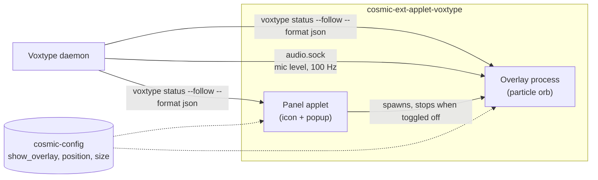

<p align="center">
  
</p>

<p align="center">
  
  
  
</p>

A [COSMIC](https://system76.com/cosmic) panel applet for [Voxtype](https://voxtype.io), the push-to-talk dictation daemon. It tells you at a glance whether Voxtype is listening, and shows a glowing particle orb that breathes with your voice while you speak.

## Features

- **Live status in the panel.** The icon follows Voxtype's state as soon as it changes:

  | State | Icon |
  |---|---|
  | Idle, ready to dictate | microphone |
  | Recording | microphone with sound waves |
  | Transcribing | document being written |
  | Daemon stopped or `voxtype` not installed | crossed-out microphone |

- **Reactive voice orb.** While you record, about 600 particles orbit on screen. Their radius, speed and shimmer follow your microphone level. When Voxtype transcribes, the orb contracts, spins faster and turns to your accent colour. When it is done, the orb fades out.
- **Never in the way.** The orb is click-through: clicks and focus go to the window underneath. It takes no CPU when you are not dictating.
- **Follows your theme.** Colours come from the active COSMIC theme and update live when you switch it.
- **Self-healing.** If the Voxtype daemon stops, the icon shows it. When the daemon comes back, the applet reconnects on its own.

## Requirements

- COSMIC desktop (tested on cosmic-comp 1.9).
- [Voxtype](https://voxtype.io) (tested with 1.1), with its user service running (`systemctl --user status voxtype`).
- To build: a Rust toolchain and [just](https://github.com/casey/just).

## Installation

No root needed: everything goes into `~/.local`.

```sh
git clone https://github.com/alexandrebouthinon/cosmic-ext-applet-voxtype.git
cd cosmic-ext-applet-voxtype
just install-user
```

Then open **COSMIC Settings → Panel** (or Dock), and add **Voxtype Applet** to your panel or dock.

If the applet is missing from the list, restart the panel with `pkill -x cosmic-panel`. The COSMIC session starts it again.

## How it works

The applet never patches or embeds Voxtype. It only talks to Voxtype's public command-line interface and to the audio-level socket that Voxtype exposes.



- **Panel applet.** COSMIC starts it when the applet is in a panel. It reads Voxtype's state stream and picks the icon.
- **Overlay.** The applet starts it as a separate process: the same binary with `--overlay`. It has to be separate because cosmic-panel proxies the surfaces of its applets, so an applet cannot draw a real click-through layer on the desktop. The overlay creates its layer surface only while you dictate. It exits on its own if the applet goes away.
- **Mic level.** It comes from `$XDG_RUNTIME_DIR/voxtype/audio.sock`. If the socket is missing, the orb still shows, idling at level 0, and reconnects in the background.

## Configuration

Click the applet icon to open its popup and turn the voice orb on or off. Turning it off only hides the orb: dictation keeps working.

The settings live in `~/.config/cosmic/io.github.alexandrebouthinon.CosmicExtAppletVoxtype/v1/`, one file per key. They apply at once, with no restart:

| Key | Values | Default |
|---|---|---|
| `show_overlay` | `true`, `false` | `true` |
| `position` | `TopLeft`, `TopRight`, `BottomLeft`, `BottomRight`, `BottomCenter` | `BottomRight` |
| `size` | `Small` (180 px), `Medium` (240 px), `Large` (300 px) | `Medium` |

For example, to move the orb to the bottom centre of the screen:

```sh
echo BottomCenter > ~/.config/cosmic/io.github.alexandrebouthinon.CosmicExtAppletVoxtype/v1/position
```

Position and size will move into the popup in a later release.

## Troubleshooting

| Symptom | Fix |
|---|---|
| Crossed-out microphone icon | The Voxtype daemon is stopped, or `voxtype` is not in your `PATH`. Check with `systemctl --user status voxtype` and `voxtype --version`. The applet recovers on its own once Voxtype is back. |
| No orb while dictating | Check that the toggle in the popup is on, and that the applet is actually in a panel or the dock: COSMIC does not start the applet otherwise. |
| The orb does not react to your voice | Voxtype is not exposing `audio.sock`. Update Voxtype, then restart it with `systemctl --user restart voxtype`. |
| Wrong microphone | Run `voxtype config set audio.device <name>`, then `systemctl --user restart voxtype`: Voxtype only picks up the new device after a restart. |
| Applet missing after `just install-user` | Run `pkill -x cosmic-panel` so the panel rescans installed applets. |

## Roadmap

- Popup with Voxtype details (model, device, backend) and orb position and size settings
- Microphone picker in the popup
- Multi-monitor support
- Start and stop recording from the applet
- Reduced-motion mode

## Development

```sh
just run      # quick run in a window (not the real panel rendering)
just verify   # fmt, clippy --fix, clippy -D warnings, tests
cargo run -- --overlay   # the orb alone; it exits when its parent does
```

Specs and sprint notes live in [`docs/`](docs). Translations use [Fluent](https://projectfluent.org). To add a language, copy [`i18n/en`](i18n/en) to your [ISO 639-1](https://en.wikipedia.org/wiki/List_of_ISO_639-1_codes) code and translate the messages.

## License

[MPL-2.0](https://www.mozilla.org/MPL/2.0/)
